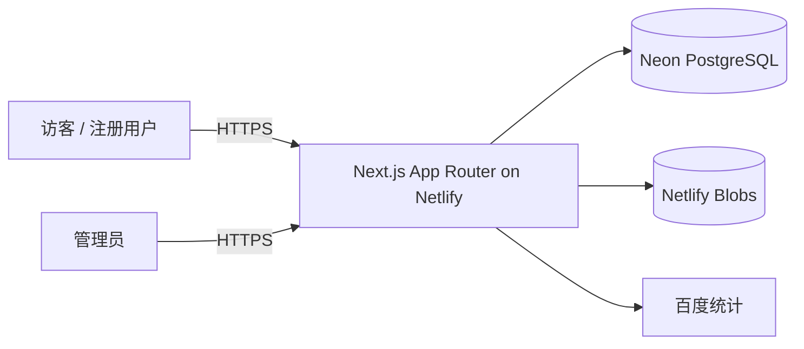

# ValuePass 概要设计

> 状态：**已实现（v1.1）**
> 日期：2026-11-09　作者：站长　依据：PRD v1.2、已实现代码
> 本文件是概要设计，详细字段、API 契约、页面级规格见后续《详细设计》。

## 1. 文档信息

### 1.1 版本记录

| 版本 | 日期 | 变更说明 |
|------|------|----------|
| v0.1 | 2026-11-05 | 概要设计初稿 |
| v1.0 | 2026-11-05 | 定稿：确认版心方案 A、Tailwind CSS、`/studio` 后台路径、Drizzle ORM、Server Actions、数据库会话、种子脚本创建管理员 |
| v1.1 | 2026-11-09 | 部署方案改为 Netlify + Neon + Netlify Blobs；Markdown 支持图片与白名单视频嵌入 |

### 1.2 已确认决策

| 决策项 | 结论 |
|--------|------|
| 版心方案 | A：通栏背景 + 内容遵守统一版心 |
| 样式方案 | Tailwind CSS |
| 后台路径 | `/studio`（不公开，仅辅助安全） |
| ORM | Drizzle ORM + drizzle-kit |
| 写操作 | Server Actions |
| 会话 | 数据库 Session + httpOnly Cookie |
| 管理员创建 | 一次性种子脚本 |
| 数据库 | Neon PostgreSQL |
| 图片存储 | Netlify Blobs |

---

## 2. 设计目标与约束

| 项 | 内容 |
|----|------|
| 产品形态 | 个人技术内容站（AI 全栈 / AI 工具 / 经验分享 / 商品展示） |
| 用户规模 | 个人站点，低并发，单管理员 |
| 团队 | 一人全栈开发 |
| 部署平台 | Netlify（免费子域名起步） |
| 数据库 | Neon PostgreSQL |
| 图片存储 | Netlify Blobs |
| 语言 | 第一版全中文 |
| 终端 | PC + 手机响应式，均为 P0 |
| 性能目标 | 首屏 < 2s，后台操作响应 < 1s |
| 范围约束 | 不做评论、在线支付、论坛、英文版、自助找回密码 |

---

## 3. 总体架构

采用 **Next.js 全栈单体架构**：页面、服务端逻辑、后台管理、接口全部在一个项目中，部署到 Netlify。



**关键决策**

1. **单仓库单体应用**：正式代码放项目根目录，`prototype/` 仅作设计参考，不参与构建。
2. **公开页面直接读数据库**：用 Server Components 查询，不额外写公开 REST API。
3. **写操作走 Server Actions**：注册/登录、后台 CRUD 统一走 Server Actions，减少接口面。
4. **文件上传走独立 Route Handler**：图片最大 5MB，Server Action 有请求体限制，单独用 `/api/upload` 处理。
5. **会话存数据库**：不用纯 JWT，便于禁用账号、退出登录、重置密码后立即失效。

---

## 4. 技术选型

| 层 | 选型 | 理由 |
|----|------|------|
| 框架 | Next.js App Router + TypeScript（strict） | SEO 友好、Netlify 官方插件支持、前后端一体 |
| 样式 | **Tailwind CSS**（主题扩展 + CSS 变量承载设计 Token） | 响应式迭代快，与 Next.js 生态一致；以原型为视觉基准重建样式 |
| 数据库 | Neon PostgreSQL | 已确认 |
| ORM | **Drizzle ORM + drizzle-kit** | 轻量、类型安全、SQL 可控、迁移简单 |
| 参数校验 | **Zod** | 表单、Server Action、上传参数统一校验 |
| 密码哈希 | **bcryptjs** | 纯 JS，Serverless 环境无原生依赖问题 |
| 会话 | 数据库 Session + httpOnly Cookie | 可撤销、可强制下线 |
| Markdown 渲染 | react-markdown + remark-gfm + rehype-raw + rehype-sanitize + 高亮插件 | 防 XSS，支持代码块与白名单视频嵌入 |
| Markdown 编辑器 | 左右分栏：textarea + 实时预览 | 与原型一致，不引入重型编辑器 |
| 图片 | Netlify Blobs + `/api/images` 代理 | 已确认；存储层可替换 |
| 统计 | 百度统计（生产环境才加载） | 已确认 |
| 测试 | Playwright（E2E）+ Vitest（关键纯函数） | 覆盖验收标准与回归 |

> 原型技术栈为纯 HTML/CSS/JS，仅作视觉与交互基准；正式实现使用 Next.js + Tailwind CSS 重新构建，目标是视觉与交互一致，不直接复用原型代码。

---

## 5. 模块划分

| 模块 | 职责 | 优先级 |
|------|------|--------|
| 公共布局模块 | 导航、页脚、移动端菜单、全局 Toast/弹窗 | P0 |
| 首页模块 | 简介、四板块入口、精选内容 | P0 |
| 文章模块 | AI 全栈 / 经验分享的列表与详情 | P0 |
| 工具模块 | 工具列表、工具详情、官网外链 | P0 |
| 商品模块 | 商品列表、详情、多图、微信咨询弹窗 | P0 |
| 关于模块 | 个人介绍、微信号、二维码 | P0 |
| 账号模块 | 注册、登录、退出、禁用校验 | P0 |
| 后台模块 | 文章/工具/商品 CRUD、精选管理、用户管理 | P0 |
| 上传模块 | 图片校验、压缩提示、Blob 存储 | P0 |
| SEO 模块 | Metadata、sitemap、robots、JSON-LD | P0 |
| 统计模块 | 百度统计 + 2 个自定义事件 | P0 |
| 状态模块 | 404、空状态、错误提示 | P0 |

**账号权限矩阵**

| 能力 | 游客 | 注册用户 | 管理员 |
|------|------|----------|--------|
| 浏览全部已发布内容 | ✅ | ✅ | ✅ |
| 注册 / 登录 / 退出 | 注册登录 | 退出 | 退出 |
| 进入 `/studio` 后台 | ❌ | ❌ | ✅ |
| 内容 CRUD / 精选 / 用户管理 | ❌ | ❌ | ✅ |

---

## 6. 路由与页面结构

**公开路由**

```
/                       首页
/articles               AI 全栈列表
/articles/[slug]        AI 全栈文章详情
/tools                  AI 工具列表
/tools/[slug]           工具详情
/insights               经验分享列表
/insights/[slug]        经验文章详情
/products               商品列表
/products/[slug]        商品详情
/about                  关于我 / 联系方式
/login                  登录
/register               注册
/sitemap.xml            sitemap
/robots.txt             robots
```

**后台路由（不在导航中出现）**

```
/studio                         后台登录
/studio/dashboard               概览与快捷入口
/studio/articles                文章列表
/studio/articles/new            新建文章
/studio/articles/[id]/edit      编辑文章
/studio/tools                   工具管理
/studio/products                商品管理
/studio/featured                精选管理
/studio/users                   用户管理
```

说明：`/studio` 只是“不公开”，不是安全边界，真正安全靠鉴权 + 限流。原型里的 `/admin/*` 仅用于演示，生产采用 `/studio/*`。

---

## 7. 数据总体设计（概念层）

| 实体 | 职责 | 关键字段（概念） | 关系 |
|------|------|------------------|------|
| `users` | 注册用户 + 管理员 | 用户名（唯一）、密码哈希、角色、状态 | 1:N sessions |
| `sessions` | 登录会话 | Token 哈希、过期时间 | N:1 users |
| `auth_attempts` | 登录失败与锁定 | 标识（用户名/IP）、失败次数、锁定截止 | 独立表 |
| `articles` | 两类文章 | 标题、slug、正文 MD、摘要、封面、板块、状态、发布时间 | N:1 users（作者） |
| `tools` | 工具条目 | 名称、slug、功能摘要、介绍、图片、官网链接、状态 | N:1 users |
| `products` | 商品条目 | 名称、slug、文字描述、上下架状态 | N:1 users |
| `product_images` | 商品多图 | 图片 URL、排序 | N:1 products |
| `featured_items` | 首页精选 | 实体类型（文章/工具/商品）、实体 ID、排序 | 应用层校验 |

**枚举约定**

- `users.role`: `USER` / `ADMIN`
- `users.status`: `ACTIVE` / `DISABLED`
- `articles.category`: `AI_FULLSTACK` / `PERSPECTIVE`
- `articles.status`: `DRAFT` / `PUBLISHED`
- `products.status`: `ACTIVE` / `OFF_SHELF`
- `featured_items.entity_type`: `ARTICLE` / `TOOL` / `PRODUCT`

**设计要点**

1. 用户表同时承载管理员和普通用户，单管理员通过种子脚本创建。
2. 文章/工具/商品均使用唯一 `slug` 生成 SEO 友好 URL；中文标题允许自定义 slug，留空则用短 ID。
3. 封面/工具图/商品图只存图片路径（`/api/images/xxx`），不存二进制。
4. 精选用统一表，保证首页可跨类型排序；删除实体时同步清理精选记录。
5. 详细字段类型、索引、约束在《详细设计》中定义。

---

## 8. 接口与数据流

### 8.1 公开读取

- 首页、列表、详情、关于页：**Server Components 直接查库**
- 已发布内容才会出现在列表、详情、sitemap
- 未发布/已下架内容返回 404

### 8.2 认证流程

```
注册：校验用户名唯一 → 密码 ≥8 位 → bcrypt 哈希 → 创建用户
      → 创建 Session → 写入 httpOnly Cookie → 自动登录
登录：校验状态（禁用则拒绝）→ 校验锁定 → 比对密码
      → 失败计数 → 5 次失败锁定 15 分钟 → 成功则重置计数并建 Session
退出：删除当前 Session → 清除 Cookie
```

### 8.3 后台写操作

- 文章/工具/商品 CRUD：Server Action + 管理员会话校验
- 精选：勾选/取消 + 排序
- 用户：禁用/启用、手动重置密码
- 所有写操作成功后调用 `revalidatePath` / `revalidateTag` 刷新公开页面缓存

### 8.4 上传

- 管理端请求 `POST /api/upload`（需管理员会话）
- 校验：登录态 → 文件类型（图片）→ 大小 ≤5MB → 生成随机文件名
- 上传至 Netlify Blobs（本地为 `uploads/`），返回路径给编辑器
- 失败返回明确错误码，前端保留已填表单

### 8.5 统一错误模型

```json
{ "ok": false, "code": "AUTH_LOCKED", "message": "尝试次数过多，请 15 分钟后再试" }
```

主要错误码：`VALIDATION_ERROR`、`AUTH_INVALID_CREDENTIALS`、`AUTH_LOCKED`、`AUTH_USERNAME_TAKEN`、`AUTH_DISABLED`、`UNAUTHORIZED`、`UPLOAD_TOO_LARGE`、`UPLOAD_TYPE_INVALID`、`NOT_FOUND`。

---

## 9. 安全设计

| 项 | 方案 |
|----|------|
| 密码存储 | bcryptjs 哈希，cost 12，禁止明文/可逆加密 |
| 会话 | 随机 Token，仅存哈希；httpOnly + Secure + SameSite=Lax；7 天过期；登录时轮换 |
| 禁用账号 | 状态置 DISABLED 并删除其全部 Session，立即失效 |
| 登录限流 | 同一账号 + IP 组合失败 5 次锁定 15 分钟（数据库记录，适配 Serverless） |
| CSRF | Server Actions 同源校验；Route Handler 校验 Origin |
| XSS | Markdown 渲染经 rehype-sanitize，不直接渲染用户 HTML |
| SQL 注入 | ORM 参数化查询，禁止拼接 SQL |
| 上传 | 仅图片类型、≤5MB、随机对象名，不信任客户端文件名 |
| 后台入口 | `/studio` 不公开 + 强制鉴权 + 登录限流（路径隐藏仅作辅助） |
| 密钥 | 全部走环境变量，`.env*` 不提交 |

---

## 10. 非功能设计

### 10.1 性能

- 公开页面优先静态生成 + 按需 revalidate；后台改动后主动刷新
- `next/image` 输出 WebP/AVIF，懒加载
- 系统中文字体栈，不加载 Web Font，降低首屏成本
- 客户端 JS 只保留必要交互组件（菜单、弹窗、编辑器）
- 目标：首屏 LCP < 2s，后台操作 < 1s

### 10.2 版心方案（已确认 A）

采用方案 A：**区块背景可以通栏，内容始终遵守统一版心**。

统一规范：

| 项 | 桌面（>1024px） | 平板（640–1024px） | 手机（<640px） |
|----|------------------|--------------------|----------------|
| 版心最大宽度 | 1200px | 100% | 100% |
| 左右留白 | 64px | 40px | 24px |
| 区块上下留白 | 80px | 56px | 44px |

- 深色「AI 工具」区保留通栏背景，内文与卡片对齐版心
- 所有页面共用同一容器组件，禁止单独写宽度
- 间距细节在《详细设计·视觉规范》中固化

### 10.3 SEO

- 每页独立 title / description / canonical / Open Graph
- 动态 `sitemap.xml`：只包含已发布文章、工具、上架商品
- `robots.txt` 屏蔽 `/studio`、`/api`、`/login`、`/register`
- 文章详情输出 Article JSON-LD
- 404 返回真实 404 状态码

### 10.4 统计

- 百度统计脚本仅生产环境加载（`next/script` afterInteractive）
- 自定义事件：
  1. 商品页微信二维码点击
  2. 工具详情页“前往官网”点击
- 事件通过 `_hmt.push(['_trackEvent', ...])` 上报，封装统一 helper

### 10.5 可访问性与兼容

- 语义化 HTML、键盘可达、可见焦点、对比度合规
- Chrome / Edge / Safari / Firefox 最新版；不支持 IE
- 断点：1440 / 1024 / 768 / 480 / 390 / 320

---

## 11. 部署与运维

| 项 | 方案 |
|----|------|
| 构建 | Netlify，`@netlify/plugin-nextjs` 自动适配；配置见 `netlify.toml` |
| 环境 | Production / Preview；预览环境不写生产数据 |
| 数据库迁移 | drizzle-kit 迁移脚本，本地手动执行（连生产 Neon），不在运行时执行 |
| 环境变量 | `DATABASE_URL`、`NEXT_PUBLIC_SITE_URL`、`BAIDU_ANALYTICS_ID`、`ADMIN_USERNAME`、`ADMIN_PASSWORD`；Blobs 凭据由平台自动注入 |
| 管理员创建 | 一次性种子脚本 `pnpm db:seed:admin`（或 npm 等价命令），只创建 ADMIN 账号 |
| 备份 | Neon 自动快照为基础；建议每周手动导出一次 SQL |
| 监控 | Netlify Function 日志 + 百度统计；错误监控（Sentry）列为 P1 |
| 域名 | 先 `valuepass.netlify.app`；后期绑定自有域名 |
| 回滚 | 依赖 Netlify 部署历史即时回滚 |

---

## 12. 关键风险与取舍

| 风险 | 影响 | 处置 |
|------|------|------|
| Netlify 国内访问波动、百度收录弱 | 搜索流量受限 | 已接受；后期自有域名优化 |
| Neon / Netlify Blobs 免费额度 | 超量需付费或限流 | 控制图片尺寸与数量，监控用量 |
| 注册登录无权益 | 用户可能不用 | PRD 已确认，作为未来铺垫 |
| 无自助找回密码 | 用户忘记密码需人工处理 | 后台提供手动重置；文案提前说明 |
| Serverless 无法用内存限流 | 多实例计数不准 | 用数据库实现账号锁定 |
| 单管理员账号 | 无协作能力 | v1 接受，后续可扩展角色 |
| Tailwind 重建样式 | 与原型存在视觉偏差风险 | 以原型为基准做像素级回归验收 |
| 内容断更 | 流量难以积累 | 上线标准与更新节奏约束 |

---

## 13. 实施阶段建议

| 阶段 | 内容 | 验收 |
|------|------|------|
| 阶段 1 | Next.js 工程初始化、Tailwind 设计 Token、数据库 Schema、账号体系、管理员种子 | 注册/登录/禁用/锁定可验证 |
| 阶段 2 | 前台六个板块页面 + 版心系统 + SEO + 响应式 | 对照原型与 PRD 验收标准 |
| 阶段 3 | 后台 CRUD、精选、图片上传、用户管理 | 完整发布流程跑通 |
| 阶段 4 | 百度统计、异常状态、性能优化、Netlify 部署 | 上线检查清单通过 |
| 阶段 5 | 填充正式内容、软上线、一周内补齐内容量 | PRD 上线标准 |

---

## 14. 后续文档

本概要设计通过后，进入《详细设计》，至少包含：

1. 数据字典：每张表的字段、类型、索引、约束
2. API / Server Action 契约：入参、出参、错误码
3. 页面级规格：组件树、间距、状态、异常分支
4. 视觉规范：Tailwind Token、版心、断点、动效
5. 测试设计：对 PRD 第 8 节验收标准逐条映射
